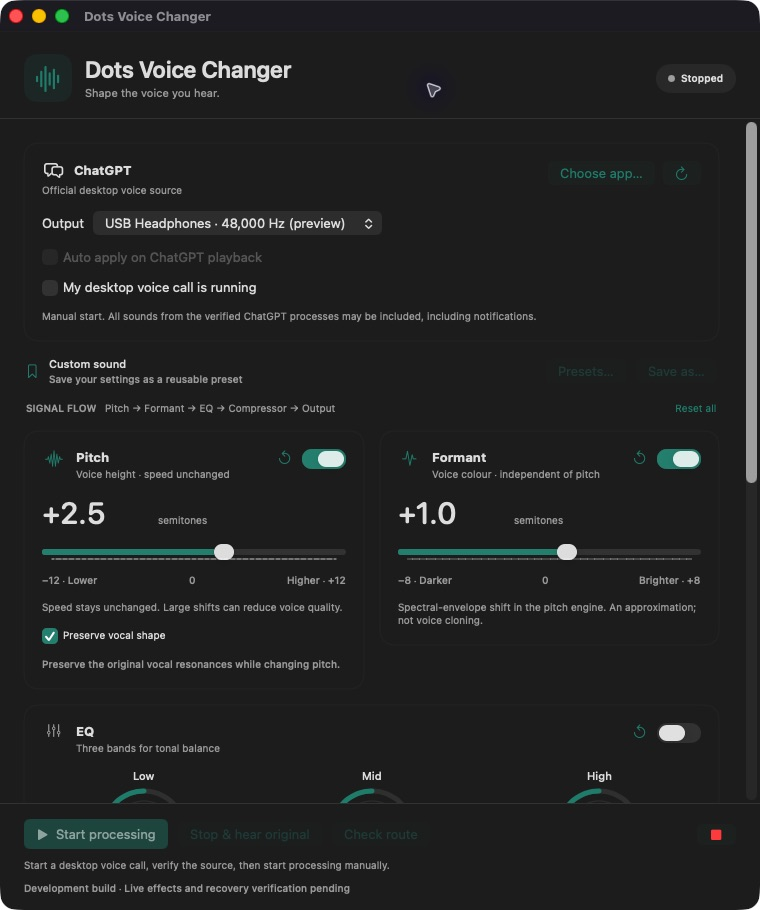
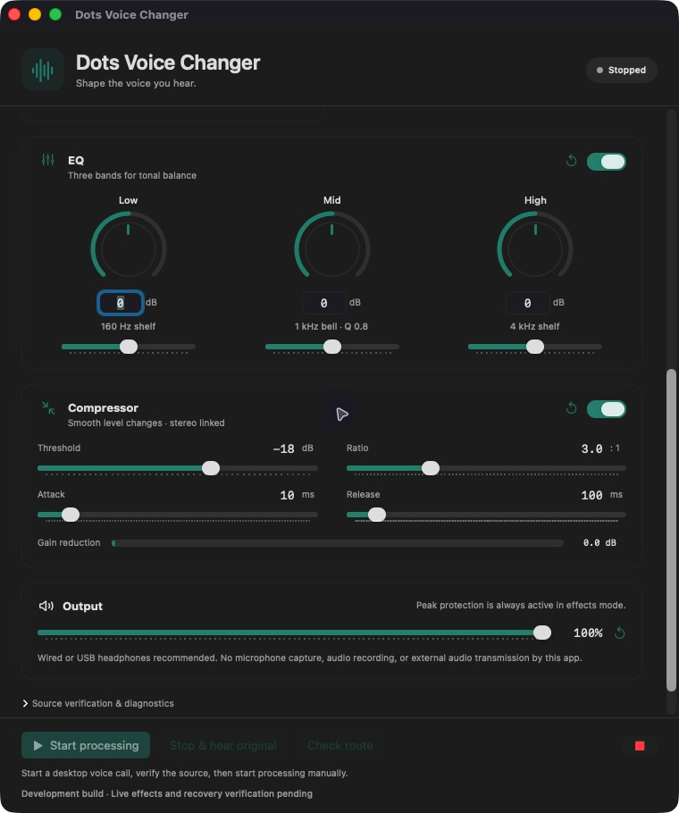

# Dots Voice Changer

Shape the ChatGPT voice you hear, locally on your Mac.

A native SwiftUI app with pitch, independent spectral formant adjustment, three-band EQ, a stereo-linked compressor, saved presets, and menu-bar controls. It captures only verified audio processes belonging to the selected official ChatGPT desktop app.

**Development build — full live-call acceptance pending.** The user reported that the new Signalsmith processing sounded natural during a ChatGPT call. A Bluetooth route check also confirmed single playback and restoration after Stop. Physical latency, isolation listening tests, and the full recovery matrix remain pending. This is not yet a validated release. See [test results](docs/TEST_RESULTS.md) for measured results and outstanding checks.

## Controls



*Native UI preview with synthetic device labels, stopped state, and no audio capture. It illustrates controls, not a completed live-call test.*

| Control | What it does |
| --- | --- |
| Pitch | −12 to +12 semitones, in 0.1-semitone steps. Equal input/output frame counts preserve nominal speech speed. |
| Preserve vocal shape | Compensates for the vocal-resonance shift introduced by changing pitch. Compare on/off at the same pitch; this is an approximation. |
| Formant | Moves an estimated vocal spectral envelope independently of fundamental pitch. This is an approximation, separate from EQ. |
| EQ | Low shelf at 160 Hz, mid bell at 1 kHz, high shelf at 4 kHz. Continuous dials/sliders and editable values. |
| Compressor | Threshold, ratio, attack, release, and gain-reduction meter. Stereo linked, soft knee, no automatic makeup gain. |
| Output | App-only playback gain. Peak protection is active in effects mode. |
| Presets | Save as, load, update, rename, and choose a preset to load at launch. |
| Check route | Capture and replay with the effects chain bypassed, for device and sound-quality comparison. |
| Stop & hear original | Stops processing, releases the tap, restores original process playback, and disarms automatic mode. |



*Native UI preview. No real device names, conversation text, or diagnostic identifiers are shown.*

## Requirements and compatibility

- macOS **14.2 or later** is the API deployment minimum. Live operation has been tested only on the environment in [test results](docs/TEST_RESULTS.md); macOS 14.2 itself has not yet been tested.
- Full Xcode with a macOS SDK is required to build. **Xcode 26.2 / SDK 26.2 / Swift 6.2.3** is the tested toolchain. The source references SDK 26 declarations behind runtime availability checks; an older SDK is not currently a supported build configuration.
- The build includes **arm64 and x86_64**. Intel compilation has passed; Intel runtime and official desktop Voice availability have not been validated. A universal binary does not establish compatibility with every Mac or every ChatGPT version.
- A running, officially signed ChatGPT desktop app with usable Voice and verifiable audio processes is required. App discovery reads the installed bundle identity; it does not assume that old ChatGPT bundle IDs remain valid.
- Wired/USB headphones are recommended. Bluetooth can change channel counts and sample rates during calls and adds device latency.

No package manager, paid API, virtual audio driver, or installed audio plug-in is required. [Signalsmith Stretch 1.3.2 and Linear 0.6.4](Vendor/Signalsmith/README.md) are bundled as pinned MIT-licensed source; builds do not download dependencies. Apple system frameworks provide the audio engine and Accelerate FFTs. Project source is [MIT](LICENSE), and the app includes [third-party notices](Resources/THIRD_PARTY_NOTICES.txt).

## Build and run

```sh
git clone git@github.com:kawayuta/ChatGPT-Dots-VoiceChanger.git
cd ChatGPT-Dots-VoiceChanger
zsh Scripts/build.sh Release
zsh Scripts/run.sh Release
```

Build output: `build/DerivedData/Build/Products/Release/DotsVoiceChanger.app`.

To use a particular installed Xcode without changing system developer settings:

```sh
export DEVELOPER_DIR=/Applications/Xcode.app/Contents/Developer
zsh Scripts/build.sh Release
```

`DOTS_DERIVED_DATA` optionally selects a different build-output folder. Both build and run scripts honor it. Open `DotsVoiceChanger.xcodeproj` and the shared `DotsVoiceChanger` scheme for development in Xcode. Scripts do not update macOS, Xcode, or system audio defaults.

Local builds use an **ad-hoc signature**. They are not Developer ID signed or notarized; there is no validated downloadable release yet. Public binary distribution needs a separate signing/notarization step. Do not disable Gatekeeper, SIP, TCC, or other security controls to run the app. See [build and permissions](docs/BUILD_AND_PERMISSIONS.md).

## First use

1. Open the official ChatGPT desktop app and start a desktop Voice conversation.
2. Open Dots Voice Changer. Confirm the target application and choose the output device in this app. The system default input/output is not changed.
3. For a new device, leave automatic mode off, confirm **My desktop voice call is running**, and use **Check route**. If macOS asks for audio capture, read the purpose and approve it yourself in the normal system prompt.
4. Confirm that ChatGPT is audible once. Choose **Stop & hear original** and confirm that its original audio returns.
5. Confirm the call again, enable Pitch, and start with a small shift such as +1 or −1 semitone. Choose **Start processing**. Compare **Preserve vocal shape** on/off before increasing the shift or adding other effects.
6. Enable Formant, EQ, and Compressor individually. Each section has bypass and reset controls; **Reset all** restores neutral settings.

Permission is for capturing the selected app's **output**. This app does not request microphone access. ChatGPT's own microphone configuration and permissions remain its responsibility. Audio and conversation text are not recorded, saved, or transmitted by Dots Voice Changer. Synthetic test fixtures are generated audio and are explicitly separate from captured call audio.

## Presets and launch behavior

Use **Save as…** to save the current effects and volume. **Update** saves edits to the selected preset. **Presets…** opens the library with **Load**, **Rename…**, and **Use at launch**.

The library also offers **Cute · Soft**: Pitch +2.5, Formant +1.0, vocal-shape preservation on, EQ/compressor off. It is a gentle starting point for a higher, brighter voice; the result depends on the original voice. **Neutral** restores zero shifts and bypassed optional effects. Trying a starting point does not overwrite a saved preset or change the launch choice. Use Save as… to keep your version.

A saved preset named **Default** is selected at launch when no explicit launch preset has been chosen. An explicit launch choice uses a stable preset UUID, so renaming that preset does not break the choice. The app initially constructs a stopped session; it never restores a previous running session. The opted-in automatic playback setting can subsequently start a newly verified session.

Presets contain sound settings only. They never include source application paths, device IDs, call state, or captured audio. Storage is local in:

`~/Library/Application Support/io.github.kawayuta.DotsVoiceChanger/presets.json`

Legacy presets keep their previous sound: the new vocal-shape option starts disabled when absent from an older preset. Enable it, compare the result, and use **Update** if you want that setting saved.

## Menu bar and automatic application

Closing the controls window leaves the app running in the menu bar. Use its waveform icon to open controls, switch presets, stop processing, or quit. No login item is installed automatically.

**Auto apply on ChatGPT playback** is an opt-in mode. It watches output activity from the verified process set, verifies the same identity on consecutive observations, and prepares playback before reading the tap. It is **not Voice-call detection**: notifications or other audio from the same verified ChatGPT processes can trigger or enter processing. An idle audio stream that remains open can also keep processing active through silence.

The first sound can play unchanged while the one-second polling and route preparation finish. Switching from original to processed sound at startup is not a claim of instant application.

The setting is remembered locally. Output inactivity stops capture; the next verified output can start a new session. **Stop**, **Emergency stop**, and an audio error disarm automatic mode. After an error, check the source and device before enabling it again. Target changes during processing trigger a safe stop; an existing tap is never expanded to additional processes.

## Audio isolation and limitations

The app verifies the selected installed application's signature, the running executable path, process start identity, helper ancestry, and the public OpenAI signing team. It enumerates Core Audio process objects and maps their PIDs to that verified app. `AudioObjectID` and PID are handled separately.

The process tap is **inclusive**, **private**, and **mutedWhenTapped**. A private tap-only aggregate has no physical microphone subdevice. Process audio is buffered and played through this app's selected output unit. No global audio capture, default-device rewrite, browser-wide fallback, or code injection is used.

`mutedWhenTapped` does not guarantee healthy playback. Callback/engine/error monitoring stops capture on detected failure and destroys resources to restore original playback. Forced-termination recovery and every device/permission transition still require the manual acceptance tests; they are not guaranteed merely by this design.

Known limits:

- AI speech cannot be separated perfectly from notifications or other sounds in the same ChatGPT process. Actual notification behavior remains to be tested.
- A browser tab, a general browser profile, or an unrelated app is not an accepted target. Browser Voice support would require a separately approved design.
- Pitch and formant shifting can introduce artifacts, especially at large shifts. The formant transform and vocal-shape preservation are approximations. One favorable live listening report does not establish naturalness for all voices or settings.
- A disconnected selected output stays unavailable until reconnected or explicitly replaced; processed audio is not silently redirected to another speaker. Device transitions stop the active route and can disarm automatic mode.
- End-to-end physical-device latency, echo with speakers, long live-call operation, microphone non-interference, and the full recovery matrix are pending. There is no zero-latency or all-device claim.
- Silent permission revocation that keeps callbacks alive cannot be reliably inferred from silent samples; silence is not treated as a fault.
- Ad-hoc build changes may require another macOS capture approval. No permission database is edited.

See [architecture and API availability](docs/ARCHITECTURE.md) and [manual acceptance checklist](docs/MANUAL_TESTS.md).

## Tests

Run in a normal local Terminal with the tested Xcode available:

```sh
zsh Scripts/test.sh standard
zsh Scripts/test-dsp.sh
zsh Scripts/test-realtime-dsp.sh
zsh Scripts/test-presets.sh
zsh Scripts/test-health.sh
zsh Scripts/test-offline.sh
zsh Scripts/soak.sh 3600
python3 Scripts/security-check.py
```

The offline test generates and analyzes 440 Hz tones at 0, ±3, and ±12 semitones at 24/44.1/48 kHz, mono/stereo; verifies frequency and 10-second duration; and compares synthetic vowel resonances with vocal-shape compensation on/off. Files under `TestResults/` are ignored by Git. These tools never capture call audio or a microphone.

The realtime DSP fixture checks bounded buffers, variable blocks, finite output, concurrent atomic controls, and C++ allocation counts. It does not instrument every allocation inside Apple frameworks. The soak test runs a software-paced independent producer with +150 ppm clock offset. It does not use a physical output or prove physical-device latency. Offline Audio Unit instantiation needs access to the normal macOS component registry; restrictive execution sandboxes may deny it.

`zsh Scripts/test.sh all` also attempts AddressSanitizer and ThreadSanitizer. Their runtimes failed before test main on the initial host, so those checks are **not passing**. Standard plain and undefined-behavior runs are reported separately.

`zsh Scripts/inspect.sh` performs read-only process/device verification and stores a private inspection under ignored `TestResults/`. Do not upload that file: it can include local device names, paths, and IDs.

## Stop, recovery, and uninstall

- Use **Stop & hear original**, the red emergency button, or **Command + .**. These disarm automatic mode and release capture.
- Use **Quit Dots Voice Changer** from the menu-bar menu to stop capture and exit. Closing the controls window only hides it.
- If an audio error occurs, leave processing stopped, check the output and capture permission, then refresh. There is no automatic restart after an error.
- If the app stops responding, quit/force-quit it and confirm original ChatGPT audio returns. Forced-exit recovery is still an acceptance test, not a verified guarantee. Restart ChatGPT if needed; do not delete unrelated audio devices or change system routing.
- To uninstall, quit the app and move your built copy to Trash. There are no installed drivers, background services, or login items. Optionally move its Application Support folder and `~/Library/Preferences/io.github.kawayuta.DotsVoiceChanger.plist` to Trash to remove saved settings. Remove the app's capture permission through System Settings if desired.

## Security, sources, and publication

See [SECURITY.md](SECURITY.md) for scope and safe reporting, [official/source references](docs/SOURCES.md), and [publication checklist](docs/PUBLICATION.md). No secrets, personal recordings, device inventories, or user presets belong in the public repository.

This is an independent project, not an OpenAI product or endorsement. ChatGPT and platform names belong to their respective owners. Project source: [MIT License](LICENSE).
